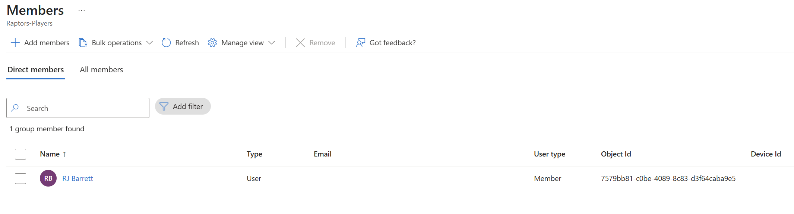
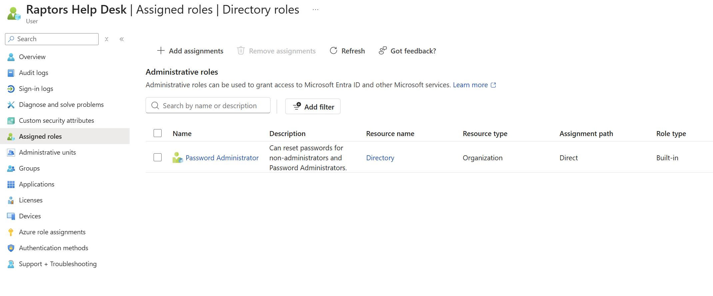
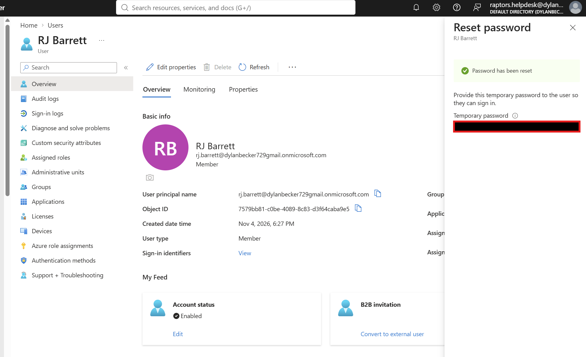
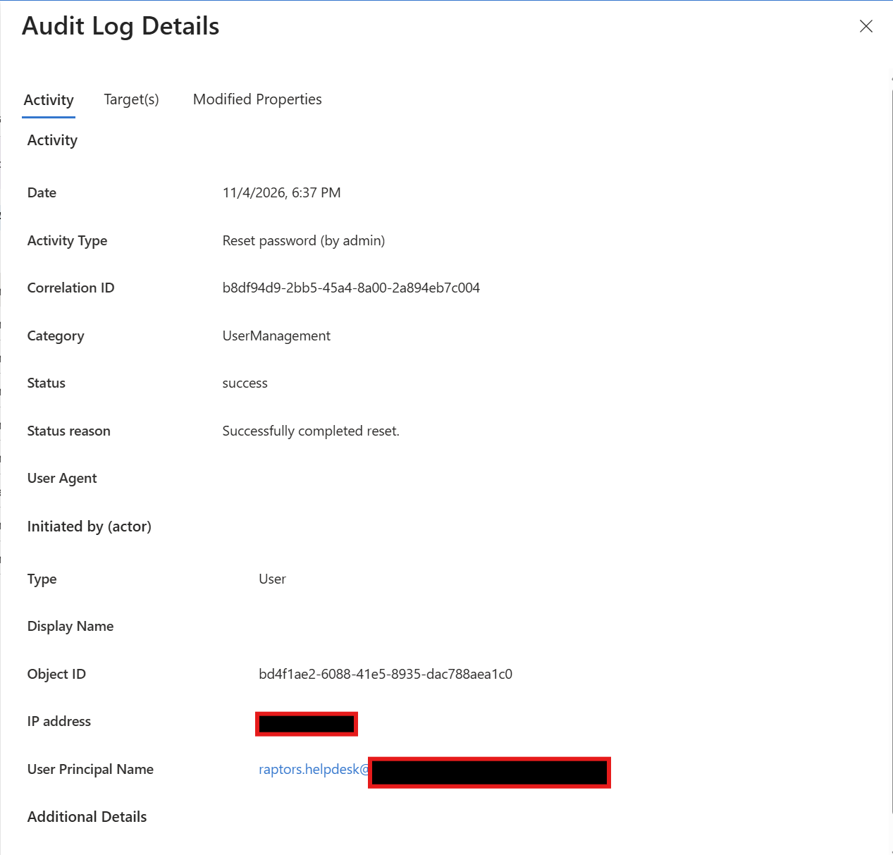
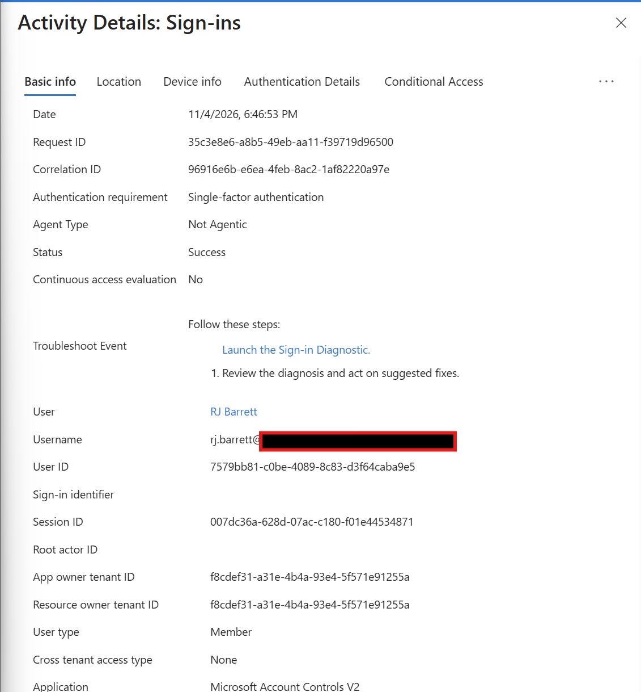
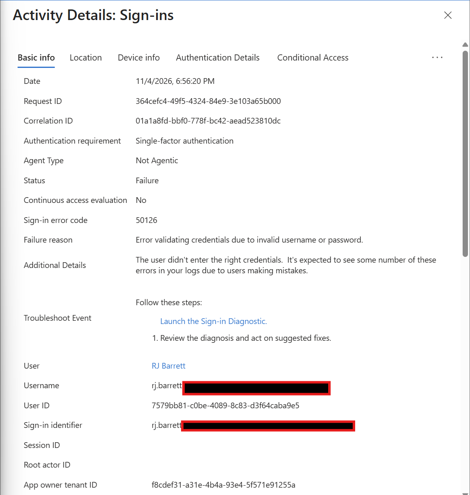

# Toronto Raptors Entra ID Lab
## Delegated Administration and Sign-In Investigation

### Overview

My favorite team is the Toronto Raptors, so I figured I could bring that into a project while building my cloud security skills. I used Microsoft Entra ID to create a Raptors themed environment where I could manage accounts, assign permissions, and investigate sign-in activity.

For this lab, RJ Barrett became my test user, and Raptors Help Desk handled password resets. The goal was to understand how these tasks work and how to find evidence of them in the logs.

This is a personal lab project and is not affiliated with the Toronto Raptors.

### Tools Used

- Microsoft Entra ID
- Microsoft Entra admin center
- Password Administrator directory role
- Audit logs and sign-in logs

### Setting Up the Accounts

I started by creating RJ Barrett’s account and adding him to a security group called **Raptors-Players**. I also created a separate **Raptors Help Desk** account for administrative tasks.

| Account or group | Purpose |
|---|---|
| RJ Barrett | Regular user account for testing |
| Raptors Help Desk | Help desk account for password resets |
| Raptors-Players | Security group containing player accounts |

The group gave me practice organizing users. At this stage, I hadn’t assigned it access to any applications or Azure resources.

### Giving the Help Desk Limited Permissions

The help desk needed to reset passwords, so I assigned it the **Password Administrator** role. There was no reason to give it Global Administrator access just to handle that task.

This helped me practice least privilege: choosing permissions based on what an account needs to do. The role was assigned at the directory level; it was not restricted to the Raptors-Players group.

### Resetting RJ’s Password

I signed in as Raptors Help Desk and reset RJ’s password. The reset succeeded, confirming that the account could perform the task with its assigned role.

Next, I checked the audit logs to see what Entra recorded. I found **Reset password (by admin)** with a **success** status and `raptors.helpdesk` listed as the account that performed it.

It was useful to connect something I had just done in the portal to the log entry it created.

### Checking a Successful Sign-In

After the reset, I signed in as RJ using the temporary password and changed it when prompted. I then returned to my administrator account and found the successful sign-in event.

The log showed RJ’s account, the time, the application, and a **Success** status. It also showed **Single-factor authentication**, so I treated this as evidence of a successful login rather than proof of MFA.

### Testing a Failed Sign-In

Next, I intentionally entered the wrong password once to see how a failed attempt would appear.

| Field | Result |
|---|---|
| User | RJ Barrett |
| Status | Failure |
| Error code | 50126 |
| Failure reason | Error validating credentials due to invalid username or password |

The event matched my test, but a failed login by itself wouldn’t tell me someone was attacking the account. In a real investigation, I’d look for patterns such as repeated failures, unfamiliar IP addresses, or a successful login following several failed attempts.

### What I Learned

This project helped me connect account management with security monitoring. I created users and a group, delegated a password reset task, and checked the logs to confirm what happened.

One takeaway was the difference between the two log types: **audit logs showed the administrative change, while sign-in logs showed the authentication attempts**. I also practiced preparing screenshots for a public write-up by hiding passwords, IP addresses, and my personal tenant domain.

There’s room to build on this with MFA testing, application access, and Microsoft Sentinel. For now, it gave me a hands-on introduction to cloud identity security—with a little Raptors theme to make it more fun.
