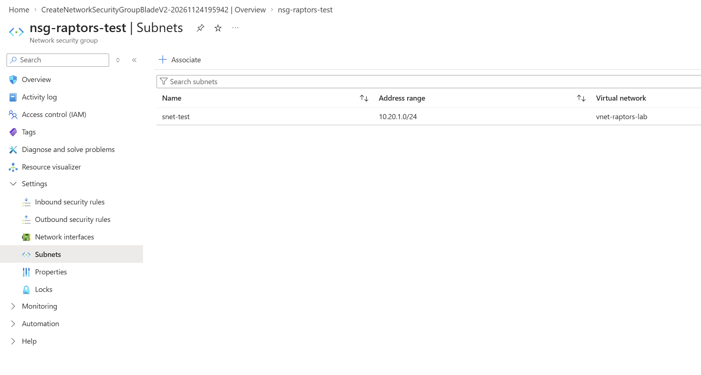
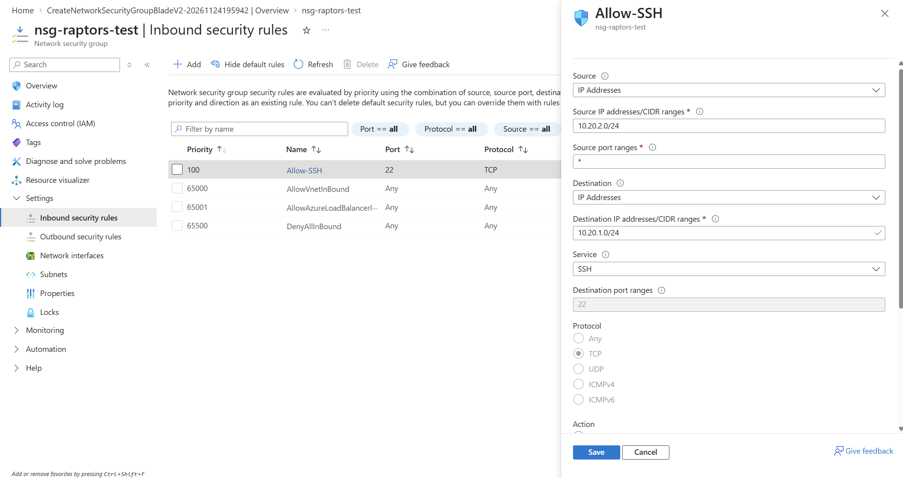
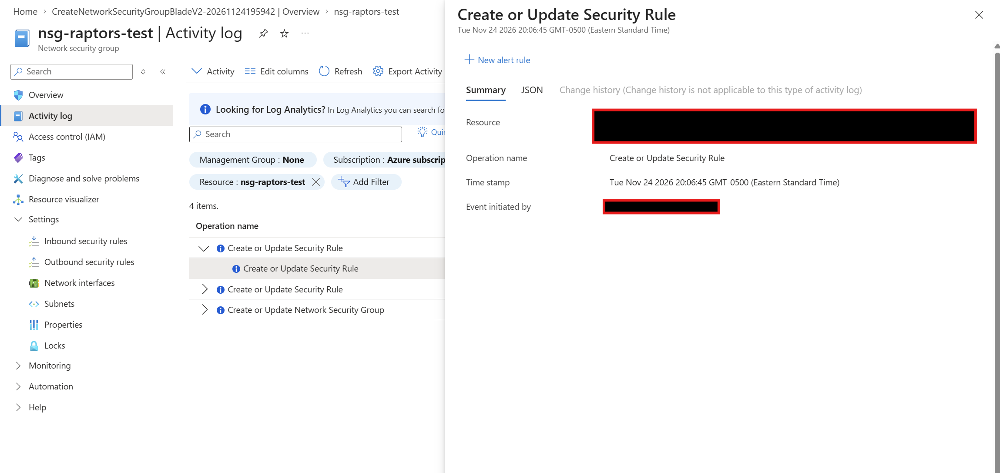
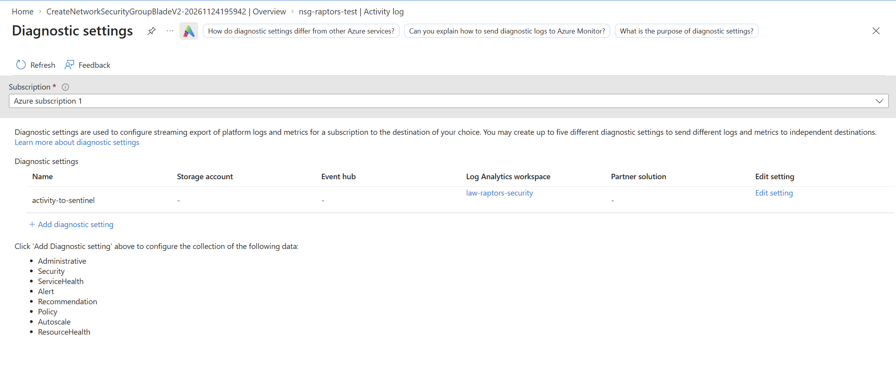
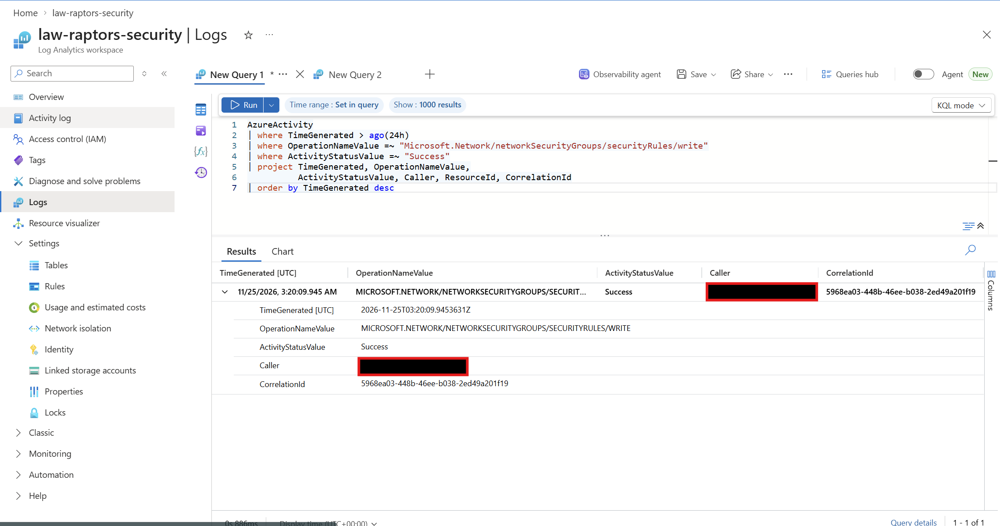
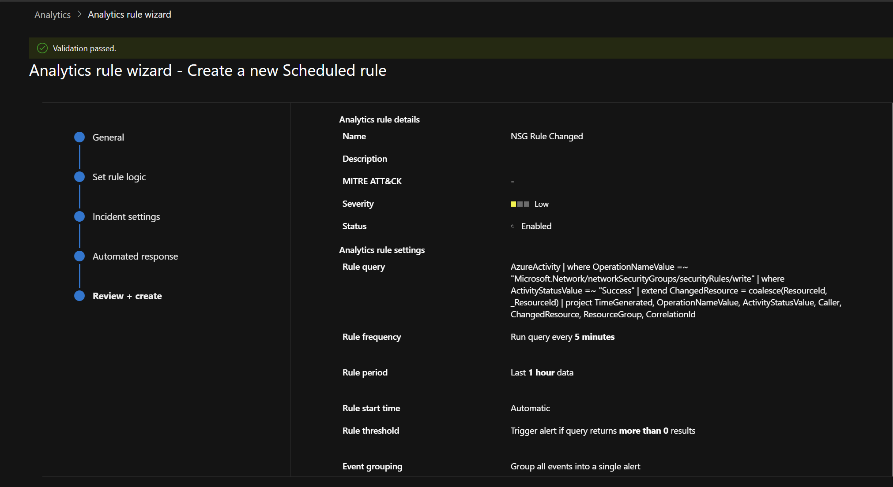
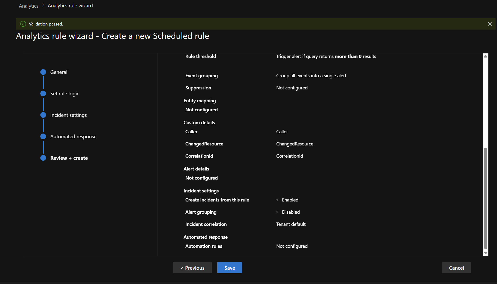
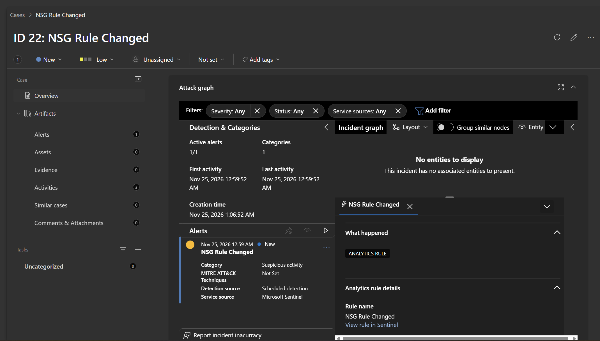
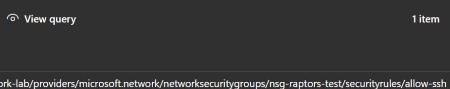

# Raptors Network Security Lab — Detecting NSG Rule Changes

After building my Raptors themed Entra ID and Sentinel labs, I wanted to bring network security into the mix. For this project, I created an Azure virtual network and Network Security Group, made a controlled rule change, and used Sentinel to detect it.

The goal was to trace a network configuration change from Azure Activity Log through a Sentinel alert and into an investigation in Microsoft Defender.

## Lab Environment

| Resource | Configuration |
|---|---|
| Resource group | `rg-raptors-network-lab` |
| Virtual network | `vnet-raptors-lab` |
| VNet address space | `10.20.0.0/16` |
| Subnet | `snet-test` — `10.20.1.0/24` |
| Network Security Group | `nsg-raptors-test` |
| Log Analytics workspace | `law-raptors-security` |
| Region | East US |

I associated the NSG with the test subnet. The subnet stayed empty during this project, so the testing focused on configuration changes and their audit trail.



## Creating the Test Rule

I created an inbound rule called **Allow-SSH** with these settings.

| Setting | Value |
|---|---|
| Source | `10.20.2.0/24` |
| Source ports | Any |
| Destination | `10.20.1.0/24` |
| Destination port | `22` |
| Protocol | TCP |
| Action | Allow |
| Priority | 100 |

I then updated the rule’s description to generate a controlled configuration change.

This rule permits the specified SSH traffic. The lab validated detection of the rule update. It did not include a live SSH connectivity test.



## Checking the Source Event

In Azure Activity Log, I found the **Create or Update Security Rule** operation for `nsg-raptors-test/securityRules/Allow-SSH`.

I checked the operation status, timestamp, initiating account, and resource path. This gave me a source record to compare with the event that eventually appeared in Sentinel.



## Sending Activity Logs to Sentinel

I configured a subscription diagnostic setting called **activity-to-sentinel** to send the **Administrative** category to `law-raptors-security`.

This collects management activity such as creating or updating Azure resources. For this project, I used the `AzureActivity` table to investigate NSG rule changes.



## Troubleshooting Log Ingestion

Getting the first events into the workspace took longer than I expected. The changes were visible in Azure Activity Log, but my Log Analytics queries initially returned no results.

I checked the saved diagnostic setting, confirmed that Administrative logging was enabled, and compared its destination resource ID with the workspace’s resource ID. I also checked public ingestion access and looked for workspace operational errors.

To verify the configuration directly, I used Azure Cloud Shell.

```bash
az monitor diagnostic-settings subscription show \
  --subscription "Azure subscription 1" \
  --name "activity-to-sentinel" \
  --output json
```

I then queried the workspace through Azure CLI. That returned seven Azure Activity records. The records later appeared in the portal as well. These checks confirmed ingestion was working, although I did not establish the exact cause of the initial delay.

## Finding the Rule Change with KQL

Once data arrived, I searched for successful NSG security rule writes.

```kusto
AzureActivity
| where TimeGenerated > ago(24h)
| where OperationNameValue =~ "Microsoft.Network/networkSecurityGroups/securityRules/write"
| where ActivityStatusValue =~ "Success"
| extend ChangedResource = coalesce(ResourceId, _ResourceId)
| project TimeGenerated, OperationNameValue, ActivityStatusValue,
          Caller, ChangedResource, ResourceGroup, CorrelationId
| order by TimeGenerated desc
```

The records included **Start**, **Accept**, and **Success** stages. I filtered for **Success** so the detection would focus on completed changes.



## Building the Sentinel Detection

I created a scheduled analytics rule called **NSG Rule Changed** in the Microsoft Defender portal.

The rule searches for successful security rule creation or updates across the connected subscription data. It returns the caller, affected resource, resource group, and correlation ID for investigation.

```kusto
AzureActivity
| where OperationNameValue =~ "Microsoft.Network/networkSecurityGroups/securityRules/write"
| where ActivityStatusValue =~ "Success"
| extend ChangedResource = coalesce(ResourceId, _ResourceId)
| project TimeGenerated, OperationNameValue, ActivityStatusValue,
          Caller, ChangedResource, ResourceGroup, CorrelationId
```

| Setting | Value |
|---|---|
| Severity | Low |
| Status | Enabled |
| Run frequency | Every 5 minutes |
| Lookback period | 1 hour |
| Alert threshold | More than 0 results |
| Event grouping | Group all events into a single alert |
| Incident creation | Enabled |

I added three custom details so the alert would carry the information needed to investigate it.

| Custom detail | Query column |
|---|---|
| Caller | `Caller` |
| ChangedResource | `ChangedResource` |
| CorrelationId | `CorrelationId` |





## Triggering and Investigating the Incident

After saving the analytics rule, I used a fresh description update to `Allow-SSH` as the test event.

While troubleshooting the missing case, I realized I had left the rule in the wizard without saving it. Once I saved and enabled it, the detection generated **case ID 22 — NSG Rule Changed**.



I opened the linked alert and reviewed the related query result. I checked that the operation succeeded, the caller matched my lab admin account, and the event time matched the update I made.


The affected resource path ended in `nsg-raptors-test/securityrules/allow-ssh`, confirming which rule had been updated.



## Closing the Case

I documented that the alert matched my authorized test change and closed the case as **Benign Positive**.

The detection correctly identified a successful NSG rule update. Reviewing the caller, timestamp, and affected resource gave me the context to determine that the activity was expected.


## What I Learned

This project helped me connect Azure networking with security monitoring. I practiced configuring an NSG, exporting subscription activity logs, writing KQL, and investigating a Sentinel-generated case.

It also reinforced the importance of checking each stage separately. A successful change in Azure Activity Log, a matching record in Log Analytics, and a saved analytics rule were all necessary parts of the workflow.

## Limitations and Next Steps

- The rule detects successful NSG security rule writes, including description-only updates. Further investigation is needed to determine whether a change expanded network access.
- The five-minute schedule and one-hour lookback can match the same event on multiple runs. I would test duplicate handling while accounting for delayed ingestion.
- The subnet was empty, so this project did not validate actual SSH traffic.
- A future version could map the caller and Azure resource as entities and enrich the alert with the rule’s source, destination, port, and action.

## Related Projects

- [Toronto Raptors Entra ID Lab](../entra-id-raptors/README.md)
- [Raptors Security Operations — Microsoft Sentinel Lab](../raptors-sentinel/README.md)
