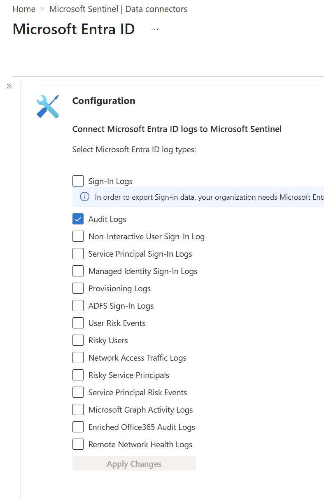
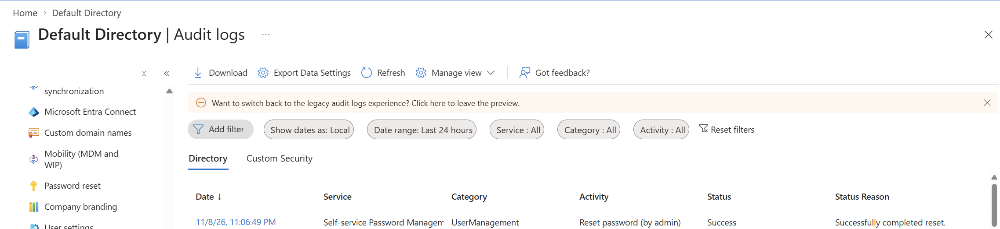
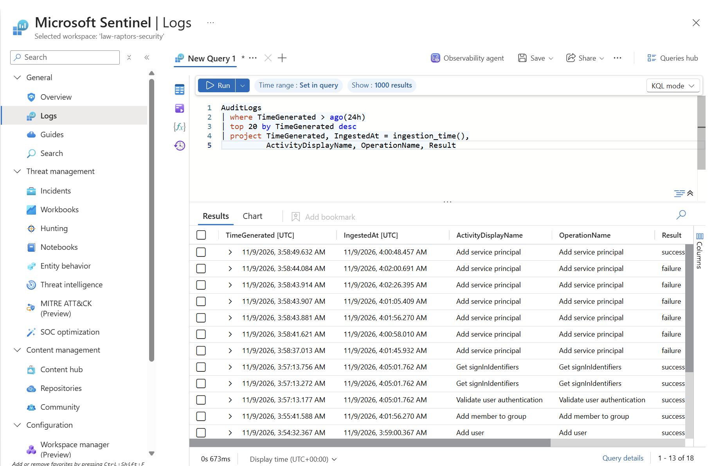
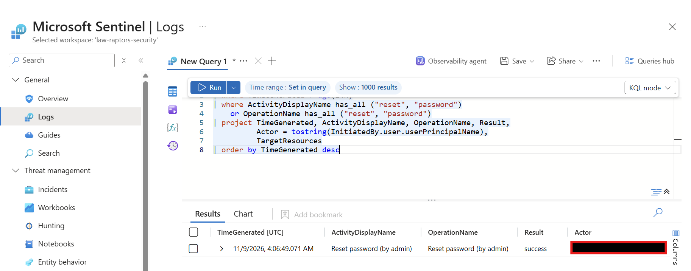
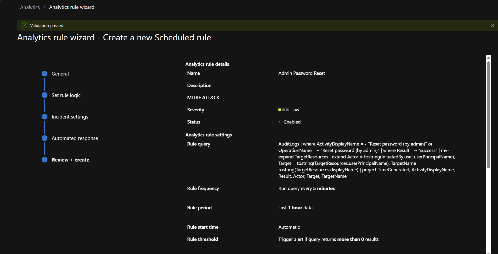
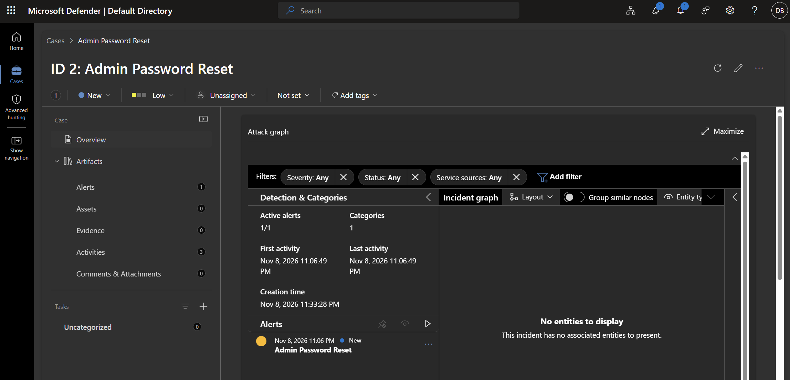
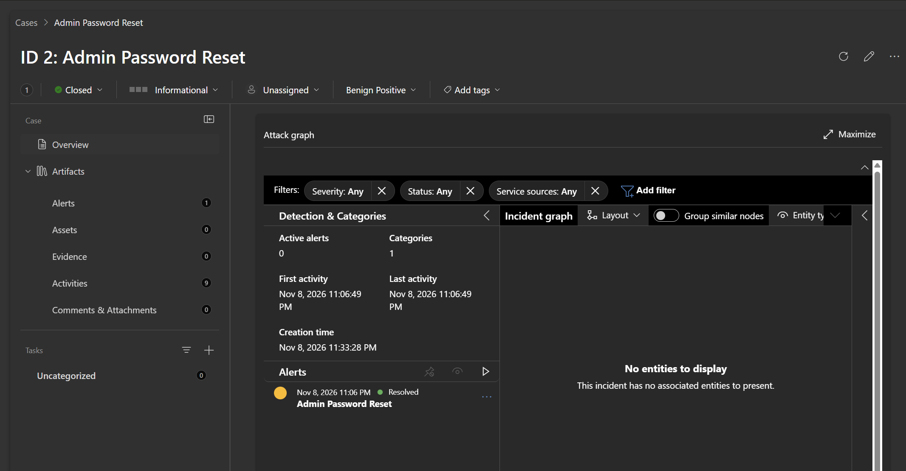

# Raptors Security Operations — Microsoft Sentinel Lab

The Raptors are my favorite team, so I kept the theme from my [Entra ID lab](../entra-id-raptors/README.md) and gave it a SOC follow-up. In the first lab, I looked up a password reset manually. This time, I wanted to see if I could get Microsoft Sentinel to detect one, open an incident, and give me enough evidence to decide what happened.

## Lab setup

I enabled Microsoft Sentinel on the `law-raptors-security` Log Analytics workspace in my personal lab tenant. I configured the Microsoft Entra ID connector to send **Audit Logs** to that workspace. The test focused on password resets, which are recorded as directory activity.




## Generating and verifying the event

I used my lab admin account to reset the password for my RJ Barrett test user. In Entra, I verified that **Reset password (by admin)** was recorded as successful. This was a separate test from the reset performed by the help desk account in my earlier Entra lab.



My first Sentinel search returned no results even though the event was already visible in Entra. I checked that **AuditLogs** was selected and routed to the correct workspace, then ran a broader query to see whether any audit data was arriving.

```kusto
AuditLogs
| where TimeGenerated > ago(24h)
| top 20 by TimeGenerated desc
| project TimeGenerated, IngestedAt = ingestion_time(),
          ActivityDisplayName, OperationName, Result
```



Once the workspace returned audit events, I narrowed the search to password resets and found the successful reset for RJ. Running the broader query first let me verify that logs were arriving before troubleshooting the reset filter.



## Building the detection

I created a scheduled analytics rule called **Admin Password Reset** in the Microsoft Defender portal. I used RJ as the test case and made the final rule match successful administrator resets across the lab tenant. The query checks both activity name fields and returns the actor, target, result, and event time.

```kusto
AuditLogs
| where ActivityDisplayName =~ "Reset password (by admin)"
    or OperationName =~ "Reset password (by admin)"
| where Result =~ "success"
| mv-expand TargetResources
| extend Actor = tostring(InitiatedBy.user.userPrincipalName),
         Target = tostring(TargetResources.userPrincipalName),
         TargetName = tostring(TargetResources.displayName)
| project TimeGenerated, ActivityDisplayName, Result, Actor, Target, TargetName
```

| Setting | Value |
| --- | --- |
| Rule severity | Low |
| Run frequency | Every 5 minutes |
| Query lookback | Last 1 hour |
| Alert threshold | More than 0 results |
| Incident creation | Enabled |



## Investigating and closing the incident

The rule triggered an **Admin Password Reset** incident in Defender. I opened case **ID 2** and followed the linked alert to the underlying query result.



The related event showed a successful reset initiated by my lab admin account and targeting RJ Barrett. I compared the actor, target, and event time with the original Entra audit entry. The reset was part of my controlled test, so I closed the case as **Benign Positive**. No remediation was needed.




## What I’d tune next

Defender showed two incidents with the same rule name. Since the rule runs every five minutes and looks back one hour, the same event can match on multiple runs. I’d compare the underlying audit event IDs to see whether that happened here. If they match, I’d test a shorter lookback or an ingestion-time filter and verify that delayed events still trigger the rule.

I’d also map the actor and target as account entities so I could go directly from the case graph to the accounts involved during a future investigation.
