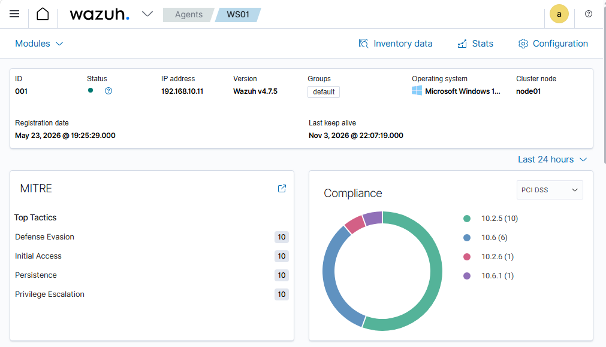
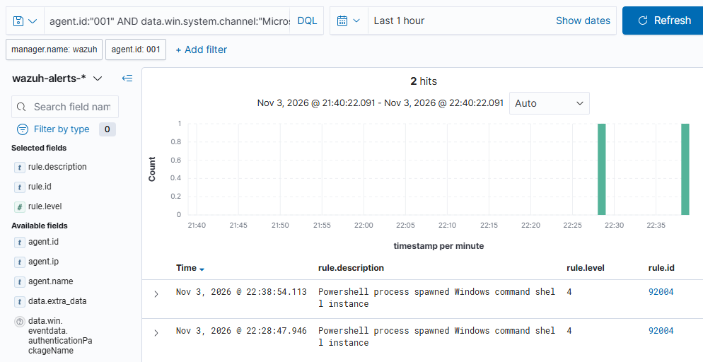
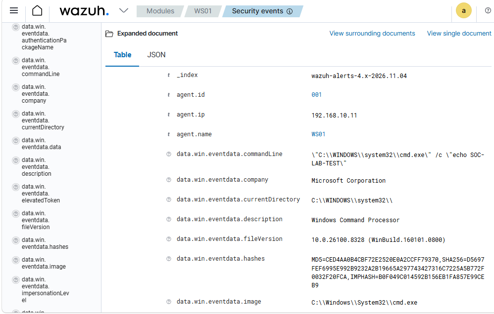
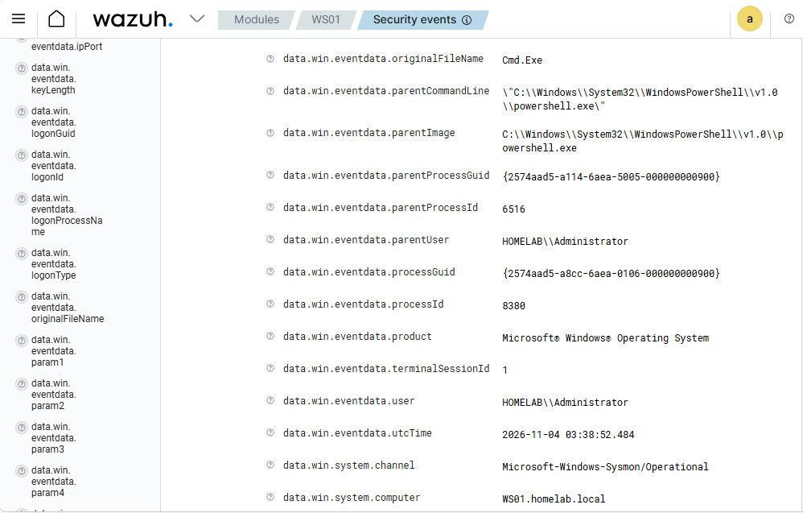

# Investigation 01: PowerShell Launching a Command Shell

## Objective

Practice investigating a process creation alert by identifying the command, user, host, and parent process. I used a harmless test command to verify Sysmon logging and Wazuh detection.

## Environment

- VMware Workstation
- Windows 11 endpoint: WS01.homelab.local
- Active Directory domain: HOMELAB
- Sysmon for endpoint logging
- Wazuh for centralized collection and alerting

## 1. Confirming Agent Connectivity

I verified that WS01 showed an active connection to the Wazuh manager before testing event collection.



## 2. Generating and Checking Test Activity

From PowerShell on WS01, I ran:

```powershell
cmd.exe /c "echo SOC-LAB-TEST"
```

This launches cmd.exe, prints a test message, and exits.

I checked the local Sysmon log for process creation events:

```powershell
Get-WinEvent -FilterHashtable @{
    LogName = 'Microsoft-Windows-Sysmon/Operational'
    Id = 1
} -MaxEvents 1 | Format-List TimeCreated, Id, Message
```

The captured event showed cmd.exe running the test command under HOMELAB\Administrator, with PowerShell as its parent.


## 3. Configuring Wazuh Collection

My initial dashboard search returned no matching results. I checked the local Wazuh agent configuration and found no Sysmon collection entry.

After backing up ossec.conf, I added this block inside ossec_config:

```xml
<localfile>
  <location>Microsoft-Windows-Sysmon/Operational</location>
  <log_format>eventchannel</log_format>
</localfile>
```

I restarted the Wazuh agent and repeated the test. During troubleshooting, I verified that:

- The agent log reported monitoring the Sysmon event channel.
- WS01 could reach the manager on TCP port 1514.
- The agent log showed a successful connection to the manager.

Alerts subsequently appeared in the dashboard. These checks helped separate local logging, collection, connectivity, and alert visibility.

## 4. Finding the Test in Wazuh

I searched Security events using:

```text
agent.id:"001" AND data.win.system.channel:"Microsoft-Windows-Sysmon/Operational" AND data.win.eventdata.commandLine:*SOC-LAB-TEST*
```

The search returned two alerts with rule ID 92004 and level 4, described as “Powershell process spawned Windows command shell instance.”



I expanded the newest result and reviewed its command line and process details.





## Findings

| Field | Observed value |
|---|---|
| Host | WS01.homelab.local |
| Agent ID | 001 |
| User | HOMELAB\Administrator |
| Executable | C:\Windows\System32\cmd.exe |
| Command | cmd.exe /c "echo SOC-LAB-TEST" |
| Parent process | powershell.exe |
| Process ID of reviewed Wazuh event | 8380 |
| Sysmon UTC time of reviewed Wazuh event | 2026-11-04 03:38:52.484 |
| Wazuh rule | 92004 |
| Alert level | 4 |

The local Sysmon screenshot and the expanded Wazuh screenshots capture separate executions of the same test command. Their timestamps and process identifiers differ, so they should not be treated as the same individual event.

## Assessment and Response

I classified the reviewed activity as an authorized benign test. The command line matched the command I intentionally ran, and the parent process and account were consistent with the test.

The alert identified a process relationship that can warrant investigation. PowerShell launching cmd.exe alone does not establish malicious activity.

For an unexpected occurrence, I would check the parent PowerShell activity, surrounding process events, account activity, and any related network or file activity before deciding whether to escalate. No containment was needed for this controlled test.

## Limitations and Follow-Up

This exercise verified a specific test behavior and its visibility in Wazuh. It did not establish that all endpoint activity was collected or that the host was free of compromise.

The agent log also contained domain trust warnings. I did not establish their cause or resolve them during this investigation, so they remain a separate follow-up task.

For future tests, I would capture the same ProcessGuid in both the local Sysmon record and Wazuh to demonstrate exact event correlation.

## What I Learned

I practiced reading process creation evidence, filtering SIEM alerts, and distinguishing an alert from a confirmed incident. I also learned to verify each stage of the logging pipeline instead of assuming an empty dashboard search meant endpoint logging had failed.
